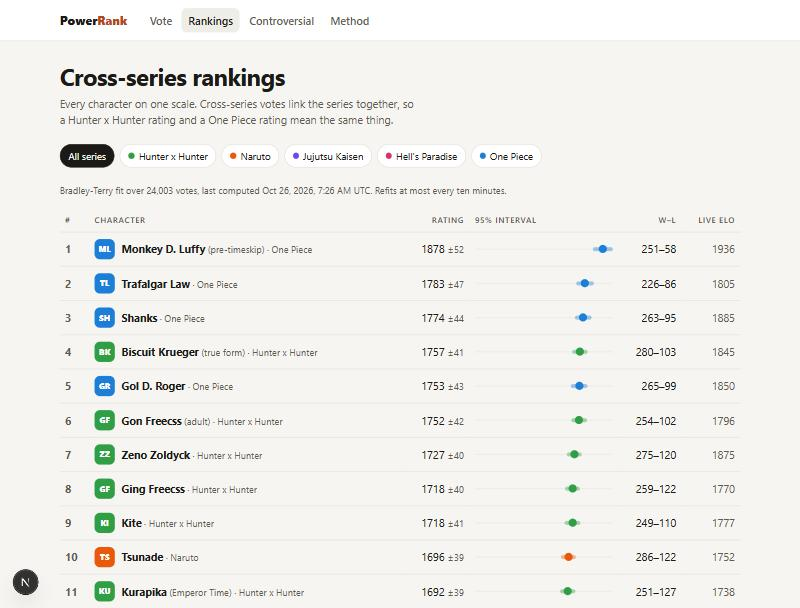

# Power Rank

Crowd-voted anime power scaling. Visitors get two characters head to head ("who wins?") and pick one. Every vote
feeds a Bradley-Terry model that ranks all characters on one scale, with a 95% interval on every rating.

Starts with Hunter x Hunter, Naruto, Jujutsu Kaisen, Hell's Paradise and One Piece (119 characters); adding a series
is a data-file edit.



> The screenshots use **simulated votes** from `npm run simulate`, whose hidden strengths are random. The order shown
> says nothing about who is actually strongest.

## What is on the site

| Page | What it does |
| --- | --- |
| `/` | Head-to-head voting. Click a card or press ← / →, then Enter for the next fight. After each vote: both characters' live Elo change and how earlier voters split. |
| `/rankings` | Cross-series board: Bradley-Terry rating, ±95% interval (drawn as a bar on a shared axis), W–L, live Elo. |
| `/rankings/[series]` | Same fit, filtered to one series. |
| `/controversial` | Pairs the crowd cannot settle, ranked by the Wilson lower bound of the losing side's share. |
| `/about` | The method, in plain language. |

## How the ranking works

- **Bradley-Terry, fitted by MM** (Hunter 2004) over all votes at once, in `src/lib/bradley-terry.ts`. Each
  character gets two virtual games (one win, one loss) against an average anchor, a weak prior that keeps an
  unbeaten 3–0 character from shooting to infinity.
- MM on its own converges very slowly along the "scale everyone together" direction. Each sweep therefore adds an
  exact Newton solve for that one direction. On the 20,000-vote recovery test, plain MM had not converged after
  10,000 sweeps; with the extra step it converges in 212.
- **Uncertainty** comes from inverting the Fisher information matrix. The standard error is taken on
  θᵢ − mean(θ): the overall level is pinned only by the prior and is not something more votes can reduce, so it is
  left out.
- **Rank threshold:** 15 real matchups before a character gets a rank. Below that it is listed as "Not ranked yet".
- **Display scale:** 1500 + θ·400/ln 10, so 1500 is the average character and 400 points means 10-to-1 odds.
- **Live Elo** (K = 32 for a character's first 30 matchups, then 16) updates on every vote, for feel only.
- **Refits:** boards refit lazily when the snapshot is more than 10 minutes old and there are new votes. A daily
  Vercel cron (`/api/cron/refit`, `vercel.json`) refits and purges old rate-limit rows. Votes are aggregated to
  pair counts in SQL first, so a fit is cheap: 119 characters and 30,000 synthetic votes fit in about 80 ms on a
  laptop.

## Matchmaking

`src/lib/matchmaking.ts` weights every pair the visitor has not voted on today by

```
weight = p(1 − p) · (σ_A² + σ_B²)
```

where p is the current win probability (largest for even fights) and σ is each rating's standard error (largest
for characters with few votes). Pairs are sampled in proportion to weight², with 10% of draws uniformly random so
every pair keeps getting data. Left/right order is randomised against position bias.

## Abuse controls, without accounts

`src/lib/abuse.ts`:

- **Visitor cookie:** a random 128-bit id, HMAC-signed (`pr_vid`, httpOnly, SameSite=Lax). The database stores
  only `HMAC(secret, id)`.
- **One vote per pair per visitor per UTC day:** a unique index on `(voter, a_id, b_id, day)` with `a_id < b_id`, so
  swapping sides does not help.
- **Matchup tokens:** each matchup is signed and bound to the visitor's id, and expires after 30 minutes. A script
  cannot vote on pairs of its choosing.
- **Rate limits** (fixed windows in Postgres): 30 votes/minute and 1,500/day per network, 20/minute per visitor, and
  5 votes per pair per network per day. The network key is `HMAC(HMAC(secret, "rl-salt:" + UTC date), ip)`: it
  rotates daily, cannot be reversed to an address, and rows older than two days are deleted. No raw IP is stored
  anywhere.
- The client IP is read from `x-forwarded-for`. On Vercel the platform sets that header. Behind any other proxy,
  make sure the proxy overwrites it, or the per-network limits can be dodged.

## Images

None, on purpose. Cards are text with a series colour and initials. AniList's API does serve character images, but
the art belongs to the publishers, and showing it would need a clear licence for this use. Text cards avoid the
question.

## Running locally

Requires Node 20+. No database install or account needed: without `DATABASE_URL` the app uses
[PGlite](https://pglite.dev) (Postgres compiled to WASM), stored in `.data/pglite`.

```bash
npm install
```

```bash
npm run dev
```

The schema and seed data are applied automatically on first request.

To fill the boards with simulated votes, **stop the dev server first** (PGlite allows one process per data
directory):

```bash
npm run simulate -- --voters 400 --votes 12 --seed 1
```

The simulator goes through the real code path: matchmaking, signed tokens, `castVote` with duplicate and rate-limit
checks, and periodic refits. It refuses to run against `DATABASE_URL` unless given `--allow-remote`. Delete `.data/`
to start over.

### Tests

```bash
npm test
```

25 vitest tests:

- `bradley-terry.test.ts`: recovers a known 30-player ordering from 20,000 synthetic votes (Spearman > 0.97, top and
  bottom exact). Across 10 seeds the 95% intervals cover the true strengths 97% of the time; the test accepts
  88–99.5%. Handles unbeaten and
  zero-game players.
- `matchmaking.test.ts`: informative pairs are picked far more often than chance, every pair still turns up, excluded
  pairs never do, and sides are balanced.
- `abuse.test.ts`: cookie and token tampering, daily key rotation, each rate limit, and one vote per pair per day
  against a real Postgres (in-memory PGlite).
- `board.test.ts`: a 3–0 character stays off the board with a wide interval, and controversy ordering.

### Environment

| Variable | Needed | Purpose |
| --- | --- | --- |
| `POWER_RANK_SECRET` | production | HMAC key for cookies, tokens and rate-limit salts. Long and random. The dev default must never ship. |
| `DATABASE_URL` | production | Postgres connection string (e.g. Neon). Unset means local PGlite. |
| `CRON_SECRET` | production | Bearer token Vercel Cron sends to `/api/cron/refit`. |
| `PGLITE_DIR` | no | Where local PGlite keeps its files (default `.data/pglite`). |

## Adding a series

Add an entry to `SERIES` and a character list to `CHARACTERS` in `src/data/series.ts`, then restart. The seed step
upserts new rows by slug. Existing characters keep their votes. Characters removed from the file are marked
inactive, not deleted.

## Deploying (not done yet)

Planned target: Vercel plus a Neon Postgres database. Create the database, set the three production variables
above, and deploy. The schema is created on first request. The daily cron in `vercel.json` works on the Hobby plan.
More frequent refits happen lazily on page views.

## Layout

```
src/data/series.ts         seed series and characters
src/lib/bradley-terry.ts   MM fit + standard errors
src/lib/matchmaking.ts     pair weights and sampling
src/lib/elo.ts             live Elo
src/lib/abuse.ts           cookies, tokens, hashed rate-limit keys
src/lib/service.ts         queries: boards, matchups, votes, controversy
src/lib/db.ts, schema.ts   PGlite / node-postgres behind one interface
src/app/                   Next.js App Router pages and API routes
scripts/simulate.ts        synthetic traffic for local development
tests/                     vitest
```

A fan project. Not affiliated with or endorsed by the creators or publishers of any series listed.
